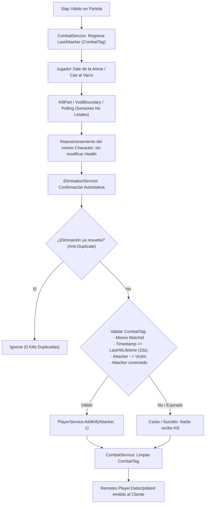

# Slap Duels 2.0 — ELIMINATION

> Especificación vigente. Define el comportamiento requerido; no certifica que la implementación ni los assets actuales hayan sido verificados en Studio.

## Kills / Elimination Attribution

### Definición y Principio Fundamental
Una **Kill** representa autoritativamente que un jugador provocó la eliminación física de un oponente durante una partida activa en estado `Playing`.

> [!IMPORTANT]
> **REGLA MANDATORIA: KILL != POINT**
> - **Kill:** Ocurre cuando un jugador golpea a otro y este es eliminado (ej. al salir de la arena y ser detectado por un sensor no letal). Otorga `+1 Kill` al último atacante válido. **NO otorga Point**.
> - **Point:** Ocurre cuando un jugador ingresa y anota en la zona de meta correspondiente (`ZoneWin`). Otorga `+1 Point` y monedas. **NO otorga Kill**.
> Ambos sistemas son **100% independientes** y responden a servicios distintos (`EliminationService` vs `ScoreService`).

### Cadena y Flujo de Eliminación


### El Último Atacante y CombatTag (`CombatService`)
- **Responsabilidad Centralizada:** Ningún script de arma o slap administra kills directamente. Los slaps invocan `CombatService:RegisterHit(attacker, victim)`.
- **Estructura del Tag:**
  ```luau
  export type CombatTag = {
      Victim: Player,
      Attacker: Player,
      MatchId: string,
      Timestamp: number,
      HitId: string?,
  }
  ```
- **Regla del Último Golpe:** Si A golpea a B, y luego C golpea a B antes de caer: **C recibe la Kill**, no A.
- **Ventana de Expiración (`LastHitLifetime`):**
  - Configurado en `Config.Combat.LastHitLifetime = 10` (segundos).
  - Si la víctima sobrevive más de 10 segundos tras el último golpe antes de la detección de caída, el tag expira y nadie recibe la Kill por ese impacto antiguo.
- **Aislamiento por MatchId:**
  - El sistema exige `attacker.MatchId == victim.MatchId`. Un golpe fuera de partida o asociado a otra arena jamás genera Kill metadata.

## Sensores, estados y deduplicación

- KillPart (sensor inferior del mapa), VoidBoundaryPart.Touched y polling convergen en _processEliminationEvent. Se valida que el sensor pertenezca al contenedor de la sesión y que la víctima sea participante.
- Solo una eliminación de combate en Playing puede otorgar kill: atacante conectado, distinto de la víctima, oponente de la misma partida y CombatTag no expirado (LastHitLifetime = 10 s).
- Sin atacante válido, la caída otorga 0 kills. En ambos casos se consume el tag y se reposiciona el mismo Character mediante ResetCharacterInArena.
- PointScorer durante PointInProgress no concede kill al rival ni genera una eliminación de combate. Ending recupera siempre a los jugadores; prevalece sobre la espera cinematográfica. Véase [Ciclo de vida](CHARACTER_LIFECYCLE.md).
- Los sensores no asignan Health=0. Humanoid.Died solo emite diagnóstico.
- El lock _processingEliminations[player] (0.5 s) deduplica contactos y polling simultáneos. Los contadores _eliminationCounters[player] identifican cada caída en _resolvedEliminations. La identidad del Character por sí sola no sirve: un personaje persistente puede sufrir varias eliminaciones válidas en una partida.
- Como máximo se concede una kill por caída. Los locks y registros se limpian al desvincular la sesión; una nueva caída válida debe poder resolverse.

### Persistencia y Economía (`PlayerService` & `PlayerDataService`)
- **Nueva Estadística Autoritativa:**
  - `PlayerService:AddKill(player, amount?, reason?)`
  - `PlayerService:GetKills(player)`
  - `PlayerService:GetPlayerData(player)` incluye `Coins`, `Wins`, `Losses`, `Kills` e `Inventory` conforme al esquema V2 de [Datos](../data/PLAYER_DATA.md).
- **Persistencia en DataStore:**
  - `PlayerDataService:ValidatePlayerData` incluye `Kills` con fallback seguro a `0`.
  - **Retrocompatibilidad:** Perfiles antiguos sin el campo `Kills` cargan con `Kills = 0` sin perder monedas, victorias ni derrotas.
- **Seguridad en Cliente:** El cliente no puede emitir eventos para adjudicarse Kills. El HUD (`PlayerHUD`) es de solo lectura y escucha `Remotes.Player.DataUpdated`.

### Soporte Multiplayer y Extensibilidad hacia Assists
- **Soporte Genérico:** Compatible con 1v1, 2v2 y 3v3 inspeccionando colecciones `RedTeam` y `BlueTeam`.
- **Historial de Impactos (`CombatHitHistoryItem`):** `CombatService` preserva el historial cronológico de golpes por víctima para implementar en fases futuras:
  - Asistencias (Assists).
  - Porcentaje de daño contribuido.
  - Kill streaks / Rachas de bajas.
  - Estadísticas de MVP y combate.

---

## Referencias relacionadas

- Slap y CombatTag: `COMBAT.md`
- Personaje persistente y protección del anotador: `CHARACTER_LIFECYCLE.md`
- Estadística Kills y persistencia: `../data/PLAYER_DATA.md`
