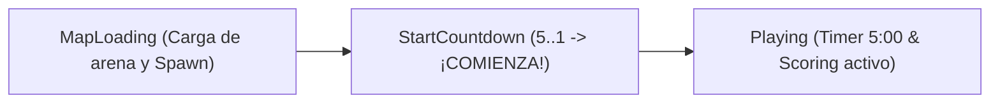
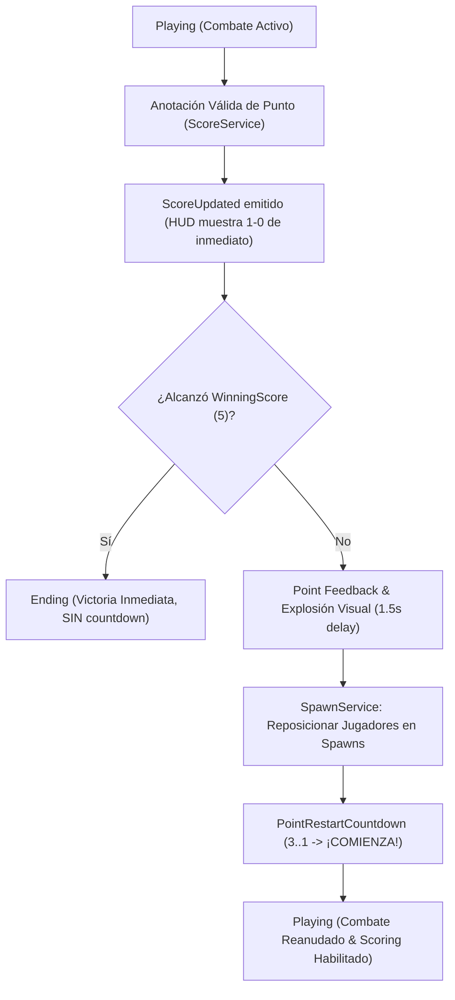

# Slap Duels 2.0 — MATCH_FLOW

> Especificación vigente. Define el comportamiento requerido; no certifica que la implementación ni los assets actuales hayan sido verificados en Studio.

## Flujo completo

Waiting → MatchReady → MatchCountdown → MapSelection → MapLoading → StartCountdown → Playing → Ending → ReturningToLobby → Waiting.

Un punto intermedio inserta PointRestartCountdown antes de volver a Playing. MatchCountdown es la preparación en lobby y no debe confundirse con los dos countdowns en arena. Cada transición y callback valida la sesión correspondiente.

El servidor conserva StartTime del primer Playing y contabiliza por separado las pausas: el tiempo restante representa combate activo, no simplemente os.clock() - StartTime. El timeout compara score y admite Draw si hay igualdad.

## Start Countdown (Conteo de Inicio Pre-Partida)

### Propósito y Filosofía
El estado `StartCountdown` introduce una transición breve, clara y tensa una vez que la arena ha sido instanciada y los jugadores han sido posicionados en sus respectivos spawns (`RedSpawn` y `BlueSpawn`), evitando que la partida arranque abruptamente sin preparación visual y espacial para los contendientes.



### Configuración Independiente
- Definido en `Config.Match.StartCountdownTime = 5`.
- **Independiente de `Config.Round.MatchCountdownTime`:**
  - `MatchCountdownTime`: Countdown de matchmaking / preparación en lobby.
  - `StartCountdownTime`: Countdown en la arena inmediatamente previo a `Playing`.

### Reglas Fundamentales de Ejecución
1. **Posicionamiento Previo y Bloqueo de Locomoción:** Los jugadores ya se encuentran en `RedSpawn` y `BlueSpawn` antes de que comience el countdown (`SpawnService:SpawnMatchPlayers` se ejecuta en `MapLoading`). Durante todo el conteo (5..1), la locomoción permanece bloqueada autoritativamente (`WalkSpeed = 0`, `JumpPower = 0`, `JumpHeight = 0`, `AutoRotate = false`, velocidades físicas a cero) mediante `SpawnService:LockSessionPlayers()` y se restaura inmediatamente al pasar a `Playing` (`SpawnService:UnlockSessionPlayers()`).
2. **Timer de Partida Congelado:** El timer de 5 minutos (`RoundDuration = 300`) **NO corre ni disminuye** durante `StartCountdown`. `session.StartTime = os.clock()` se registra estrictamente en el instante de transición a `Playing`.
3. **Scoring Inactivo:** `ScoreService:StartScoring(session)` no se ejecuta durante `StartCountdown`. Las zonas de victoria (`RedWin` y `BlueWin`) rechazan activaciones (`_validateScorer` exige `currentState == Constants.RoundState.Playing`).
4. **Emisión Autoritativa del Servidor:**
   - Durante cada segundo (5, 4, 3, 2, 1), `RoundService` emite el remote `Remotes.Match.Countdown` con payload `{ MatchId = session.Id, Value = t, Started = false, Phase = "MatchStart" }`.
   - Al finalizar, emite la señal de inicio ("GO") con `{ MatchId = session.Id, Value = 0, Started = true, Phase = "MatchStart" }`.
5. **Transición a Playing:** Inmediatamente tras emitir el valor 0, la partida pasa a `Constants.RoundState.Playing`.

### Manejo de Desconexiones y Cancelación
- Si un jugador se desconecta durante `StartCountdown`:
  - `RoundService:_handlePlayerLeaving` detecta el estado `StartCountdown` e invoca `_cancelSession("PlayerDisconnected")`.
  - El hilo `_sessionThread` se cancela de forma inmediata (`pcall(task.cancel)`), interrumpiendo cualquier bucle de espera.
  - Se retornan los jugadores restantes al lobby, se destruye la arena en `MatchInstanceService` y el estado vuelve a `Waiting`.
  - Nunca se transiciona a `Playing` ni se inician servicios de scoring para una sesión cancelada.

### Point Restart Countdown (Reinicio Autoritativo de Punto - 3 Segundos)

#### Objetivo y Flujo
Tras la anotación válida de un punto (ej. Red 1 - 0 Blue), la partida no continúa de inmediato. Se ejecuta un countdown de 3 segundos (`3 → 2 → 1 → ¡COMIENZA!`) con reposicionamiento de jugadores y Game Feel cinematográfico antes de retomar `Playing`.



#### Reglas de Ejecución y Autoridad del Servidor
1. **Diferenciación de Estados:**
   - `StartCountdown` (5 segundos): Ocurre una única vez al inicio formal de la partida tras cargar la arena.
   - `PointRestartCountdown` (3 segundos): Estado intermedio tras cada punto anotado antes de que algún equipo alcance `WinningScore`.
2. **Pausa y Preservación del Timer:**
   - El countdown de 3 segundos actúa como una pausa entre puntos.
   - **`session.StartTime` NO se reinicia** tras un punto. Permanece fijado desde el inicio original del match.
   - **`RoundDuration` (5:00) NO se altera ni se incrementa artificialmente**. El decremento del tiempo de combate se suspende durante el countdown y se reanuda de manera continua al regresar a `Playing`.
   - Si el timer llega a `0` durante `Playing`, el ganador se determina de inmediato por `ScoreService:GetWinner` y la partida transiciona a `Ending` sin iniciar ningún countdown.
3. **Punto Final / WinningScore:**
   - Si un equipo alcanza `WinningScore = 5` (o en un eventual 5 - 4), la partida transiciona **inmediatamente** a `Ending` declarando la victoria. **NO se inicia el countdown de 3 segundos**.
4. **Bloqueo Autoritativo de Scoring:**
   - Durante `PointRestartCountdown`, el scoring se encuentra completamente deshabilitado en dos capas:
     - Atómica en `ScoreService`: `_pointInProgress[matchId] = true`.
     - Validación de estado: `_validateScorer` y `_checkSpatialScoring` verifican estrictamente `currentState == Constants.RoundState.Playing`.
   - Es imposible marcar anotaciones consecutivas o acumular dobles puntos durante la pausa o el countdown.
5. **Reposicionamiento Físico y Bloqueo de Locomoción:**
   - Antes de iniciar el conteo de 3 segundos, `RoundService` invoca `SpawnService:SpawnMatchPlayers(session)` y `SpawnService:LockSessionPlayers(session)` para teleportar, estabilizar y bloquear autoritativamente la locomoción de los contendientes (`WalkSpeed = 0`, `JumpPower = 0`, `JumpHeight = 0`, `AutoRotate = false`, velocidades residuales a cero).
   - Se restaura de inmediato el movimiento normal al culminar el countdown y reanudar el combate en `Playing` (`SpawnService:UnlockSessionPlayers()`).
   - `ScoreService:ResetZonePresences(matchId)` limpia cualquier registro previo de contacto físico con las zonas.
6. **Manejo de Desconexiones:**
   - Si un jugador abandona durante `PointRestartCountdown`, `RoundService:_handlePlayerLeaving` lo detecta, cancela el hilo `_pointRestartThread`, declara ganador al oponente restante y pasa a `Ending` con cleanup exhaustivo.

#### Contrato de Remote y Sincronización
- Reutiliza el evento `Remotes.Match.Countdown` extendido con el campo tipado `Phase`:
  ```luau
  {
      MatchId = session.Id,
      Value = 3, -- 3, 2, 1, 0
      Started = false, -- true en 0 ("¡COMIENZA!")
      Phase = "PointRestart", -- o "MatchStart"
  }
  ```

---

## Presentación y continuidad física

La estructura editable del HUD está en [UI](../presentation/UI.md), y la animación en curva C y perfiles audiovisuales en [Game feel](../presentation/GAME_FEEL.md). Todo reposicionamiento conserva el Character según [Ciclo de vida](CHARACTER_LIFECYCLE.md). Ending estabiliza inmediatamente a los participantes; no inicia otro countdown.
